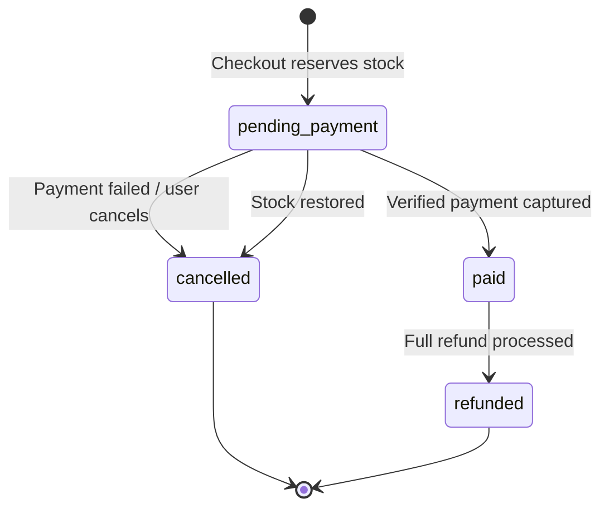
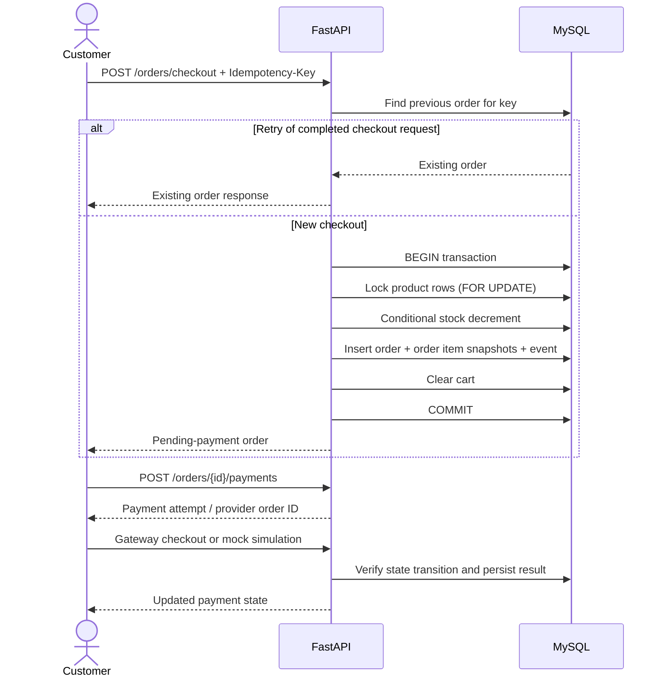
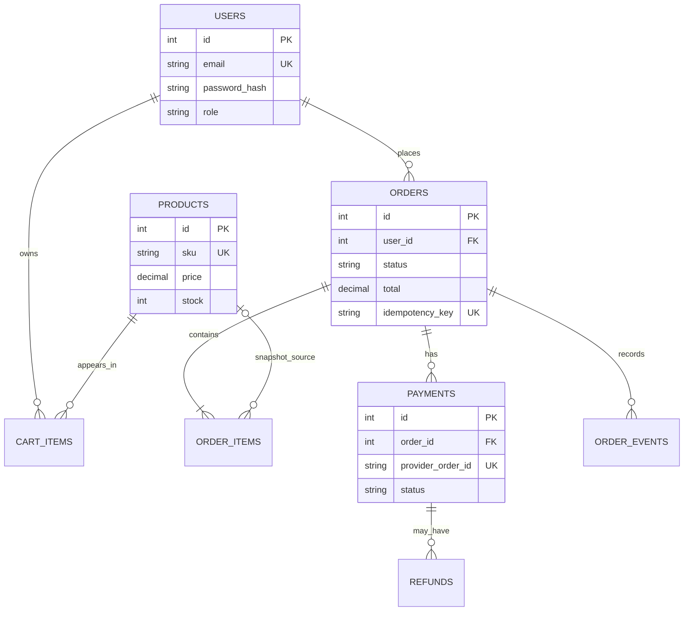

# OrderFlow architecture notes

## Order lifecycle

## Checkout sequence

## Relational model

## Important implementation decisions

- Prices and totals are `Decimal` values stored in SQL `NUMERIC` columns to avoid floating-point currency errors.
- The order line stores product name, SKU and unit price at purchase time. A later catalogue edit therefore does not rewrite purchase history.
- `Idempotency-Key` values are namespaced with the authenticated user ID before being stored, avoiding cross-customer key collisions.
- MySQL checkout uses row locks plus a conditional stock decrement. A conditional update (`stock >= requested_quantity`) is still used as a final guard.
- Payment state changes are applied only after a valid mock action or a signature-verified Razorpay webhook.
- New registrations cannot self-assign the administrator role. Admin promotion is an explicit one-time CLI operation.
